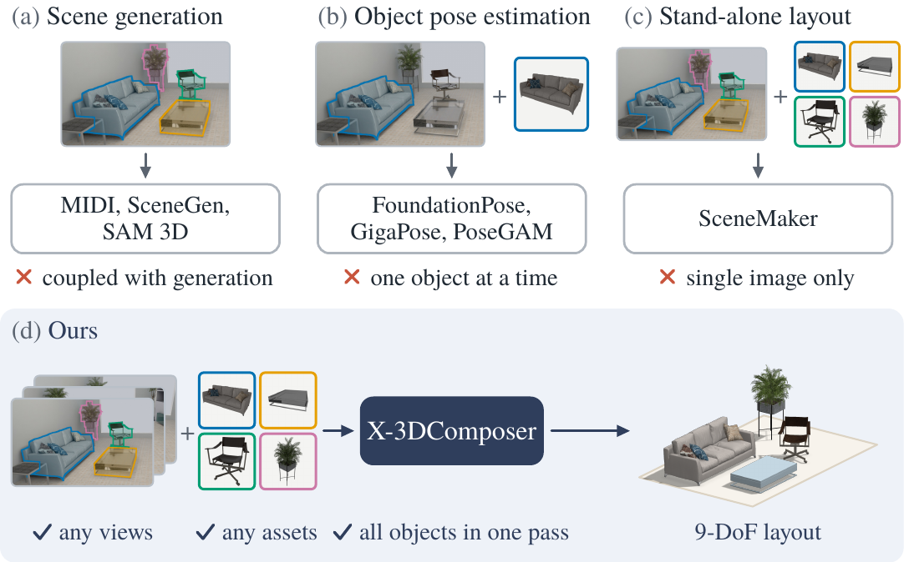
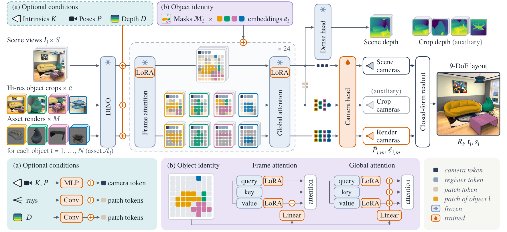

<div align="center">
<h1>X-3DComposer</h1>
<h3>Feed-Forward 3D Scene Composition with Any Assets from Any Views</h3>

<a href="https://arxiv.org/abs/2611.32491"></a>
<a href="https://github.com/qiuzidian/X-3DComposer"></a>
<a href="https://huggingface.co/AutumnSonsweet/X-3DComposer"></a>

<p>
  <strong>Zidian Qiu</strong> &nbsp; <strong>Ancong Wu</strong><sup>&#9993;</sup>
  <br>
  Sun Yat-sen University
  <br>
  <sup>&#9993;</sup> corresponding author
</p>


</div>

X-3DComposer predicts the **layout** of a scene: given one or more images, the masks of the objects and one 3D
asset per object (from a CAD library, retrieval or a 3D generator), it predicts the rotation, translation and
per-axis scale of **all objects in a single forward pass**, without test-time optimization. Camera intrinsics,
camera poses and depth are optional inputs.

The idea is to treat **objects as views**: renders of the assets are processed together with the scene images
by a multi-view geometry model adapted from [VGGT-Ω](https://github.com/facebookresearch/vggt-omega), and each
object pose follows in closed form from the cameras predicted for its renders.

<div align="center">

</div>

## News

- [2026-11] Paper released on [arXiv](https://arxiv.org/abs/2611.32491); code and weights released.

## Installation

```bash
git clone https://github.com/qiuzidian/X-3DComposer && cd X-3DComposer
pip install -r requirements.txt            # PyTorch >= 2.6 with CUDA, NumPy, Pillow, safetensors, trimesh, ...
pip install "vggt-omega @ git+https://github.com/facebookresearch/vggt-omega@48b23c8ce72c9a8fcf987f0d7f43d8e4870759f6"
pip install -e .
```

X-3DComposer builds on the **VGGT-Ω 1B** backbone. Request access to its checkpoints at
[facebook/VGGT-Omega](https://huggingface.co/facebook/VGGT-Omega) and download
`vggt_omega_1b_416_reproduce.pt`. Our weights contain only what we trained on top of it (about 18 M
parameters, 71 MB).

| Model | Backbone | Trainable parameters | Weights |
|:---|:---|:---:|:---:|
| `X-3DComposer` | VGGT-Ω-1B-416-Reproduction | 17.8 M | [`AutumnSonsweet/X-3DComposer`](https://huggingface.co/AutumnSonsweet/X-3DComposer) |

## Quick start

The repository ships a small example, [`examples/ycbv_tabletop`](examples/README.md): two photos of six
objects on a table with object masks, camera parameters, depth, and one pre-rendered asset per object.

```python
import numpy as np
from PIL import Image
from x3dcomposer import Asset, SceneObservation, X3DComposer, compose, export_glb, save_layout

model = X3DComposer.from_pretrained(
    "AutumnSonsweet/X-3DComposer",                                              # Hugging Face repository or local directory
    backbone_weights="path/to/vggt_omega_1b_416_reproduce.pt",
).cuda()

root = "examples/ycbv_tabletop"
names = ["cracker_box", "pudding_box", "gelatin_box", "banana", "mug", "scissors"]   # mask value i + 1
cameras = np.load(f"{root}/cameras.npz")
scene = SceneObservation(
    images=[np.asarray(Image.open(f"{root}/images/view{j}.jpg")) for j in range(2)],
    masks=[np.asarray(Image.open(f"{root}/masks/view{j}.png")) for j in range(2)],   # 0 = background
    intrinsics=cameras["K"],                                                          # optional
    poses=cameras["c2w"],                                                             # optional
    depths=[np.asarray(Image.open(f"{root}/depth/view{j}.png")) * 1e-3 for j in range(2)],   # optional, metres
)
assets = [Asset(f"{root}/assets/{name}") for name in names]

layout = compose(model, scene, assets)                            # one forward pass
for item in layout.objects:
    print(item["asset_id"], item["R"], item["t"], item["scale"])

save_layout(layout, "out/layout.json")
export_glb(layout, "out/scene.glb")                               # the meshes placed in the scene
```

Poses are given in the camera frame of the first image (OpenCV axes): a point `p` of the normalized asset maps
to `R @ diag(scale) @ p + t`, and `mesh_pose` maps the coordinates of the original mesh file directly. A single
image with masks and assets is enough; drop `intrinsics`, `poses` and `depths` to try it.

The same from the command line:

```bash
E=examples/ycbv_tabletop
python demo.py --weights AutumnSonsweet/X-3DComposer --backbone path/to/vggt_omega_1b_416_reproduce.pt \
    --images $E/images/view0.jpg $E/images/view1.jpg --masks $E/masks/view0.png $E/masks/view1.png \
    --assets $E/assets/cracker_box $E/assets/pudding_box $E/assets/gelatin_box \
             $E/assets/banana $E/assets/mug $E/assets/scissors \
    --cameras $E/cameras.npz --depths $E/depth/view0.png $E/depth/view1.png --output out/
```

### Preparing assets

The model sees each asset through rendered views. Render them once per asset with Blender (the `bpy` module):

```bash
pip install bpy            # Blender 4.2 - 4.5 as a Python module
python tools/render_asset.py sofa.glb --output assets/sofa
```

The mesh must have +Y up (the glTF convention). The asset directory format is described in
[docs/DATA.md](docs/DATA.md).

### Inputs

| Input | Required | Notes |
|:---|:---:|:---|
| Scene images | yes | One or more views of the scene, all of the same size. |
| Object masks | yes | One id map per image; an object may be missing from some views. |
| Assets | yes | One per object; the asset need not match the object exactly. |
| Intrinsics `K` | no | |
| Camera poses `P` | no | Relative poses of the views; need `K`. Only useful with several views. |
| Depth `D` | no | Sensor or estimated depth; needs `K`. |

### Condition modes

`compose(..., mode=...)` selects which geometric conditions are given to the model. `auto` (default) uses
everything the scene provides.

| Mode | Given to the model | Unit of the output |
|:---|:---|:---|
| `none` | images, masks and assets only | normalized (mean scene distance to the first camera = 1) |
| `K` | + intrinsics | normalized |
| `K+P` | + camera poses | unit of the poses (if the cameras have a baseline) |
| `K+D` | + depth | unit of the depth |
| `K+P+D` | + poses and depth | unit of the depth |

If intrinsics or depth of a **single** image come from a monocular estimator rather than a sensor, pass
`conditions_estimated=True` (`--estimated`): `auto` then gives the model the image, masks and assets only.

Other options of `compose`: `renders_per_object` (1 - 8, default 4), `known_sizes` (use a known object size
instead of the predicted scale) and `candidate_policy` (`mean` fuses the pose candidates of all renders).

## Training

Training needs scenes with 9-DoF object annotations in the format of [docs/DATA.md](docs/DATA.md), and a clone
of the backbone repository for its scene-view losses:

```bash
git clone https://github.com/facebookresearch/vggt-omega third_party/vggt-omega
git -C third_party/vggt-omega checkout 48b23c8ce72c9a8fcf987f0d7f43d8e4870759f6

python tools/build_visibility.py data/scenes/*                     # once per dataset
python tools/validate_dataset.py --scenes data/scenes_train.txt --assets data/assets --samples 4

python -m x3dcomposer.train --config configs/release.yaml                          # one GPU
torchrun --nproc_per_node 8 -m x3dcomposer.train --config configs/release.yaml     # eight GPUs
python -m x3dcomposer.train --config configs/release.yaml --resume runs/x3dcomposer/checkpoint.pt

python tools/export_weights.py runs/x3dcomposer/checkpoint.pt --output weights/    # EMA weights for inference
```

Any option can be overridden on the command line, e.g. `optim.steps=1000 data.workers=4`. The default
hyperparameters follow the paper.

## Repository layout

```
x3dcomposer/
  models/      backbone wrapper, LoRA, identity embeddings, condition encoders, the model
  inference/   input preparation, pose readout, export
  data/        scene / asset readers, view preparation, sampling, conditions, augmentation
  losses/      training objective
  geometry/    cameras, pixel maps, asset viewpoints, crop-camera fit
  train.py     training loop (single GPU and DDP)
tools/         render_asset.py, build_visibility.py, validate_dataset.py, export_weights.py
demo.py        command-line inference
examples/      a small example scene with pre-rendered assets
docs/DATA.md   data format
```

## License

- **Code**: [CC BY-NC 4.0](LICENSE).
- **Model weights**: [FAIR Noncommercial Research License](LICENSE_WEIGHTS). The weights are derived from the
  VGGT-Ω weights and are distributed under the license of VGGT-Ω.

The example data under `examples/` has its own license, see [examples/README.md](examples/README.md).

## Citation

```bibtex
@article{qiu2026x3dcomposer,
  title   = {X-3DComposer: Feed-Forward 3D Scene Composition with Any Assets from Any Views},
  author  = {Qiu, Zidian and Wu, Ancong},
  journal = {arXiv preprint arXiv:2611.32491},
  year    = {2026}
}
```

## Acknowledgements

This work builds on [VGGT-Ω](https://github.com/facebookresearch/vggt-omega) and
[VGGT](https://github.com/facebookresearch/vggt). The model was trained on data derived from 3D-FRONT,
3D-FUTURE, HSSD, InternScenes, MolmoSpaces, SAGE, SceneSmith, ScanNet++ (with SCANnotate++ and ShapeNet), Pix3D,
the BOP datasets, Google Scanned Objects and GraspNet-1Billion. We thank the authors of these projects and
datasets.
